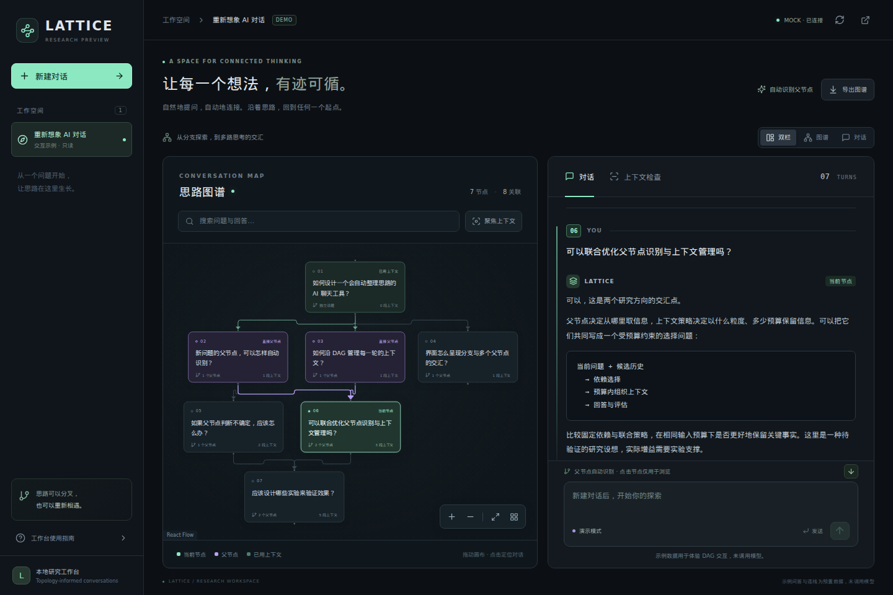

# LATTICE

**Linked Agent Turns with Topology-Informed Context Engineering**

一个用于探索「自动对话依赖 DAG + 上下文管理」的聊天研究框架。用户照常提问，系统自动选择历史父节点、组织本轮上下文、调用模型，并保存问答及其依赖关系。也可以在图上指定父节点，或调整已有节点的父节点并重新生成回答。

目前提供 React + TypeScript + React Flow 前端、FastAPI、命令行和持久化对话图。默认使用离线 mock 模型，可先验证整个流程，再接入本地 vLLM 或付费 API。现有选择和压缩策略是可替换的基线，不代表已实现新的科研算法。



## 快速开始

需要 Python 3.11 或更新版本。在本项目目录执行：

```bash
python -m venv .venv
.venv/bin/python -m pip install -e '.[dev]'
.venv/bin/lattice demo --config config.yaml
.venv/bin/lattice serve --config config.yaml
```

服务启动后打开 <http://127.0.0.1:8000/docs> 使用交互式 API 文档。默认配置无需 API key，不会访问模型服务；mock 回答只用于调试流程，不具备真实模型的回答能力。

### 启动聊天前端

前端需要 Node.js 18 或更新版本。保持后端运行，在另一个终端执行：

```bash
cd frontend
npm ci
npm run dev
```

打开 <http://127.0.0.1:5173>。Vite 将 `/api` 和 `/healthz` 请求代理到 `http://127.0.0.1:8000`，无需额外修改 CORS。后端端口不同时，在启动前端时设置目标地址：

```bash
LATTICE_API_TARGET=http://127.0.0.1:8002 npm run dev
```

界面提供会话列表、聊天记录、依赖 DAG，以及节点检查面板。平时点击图节点可定位原始问答；开启父节点选择后，直接点击图节点进行多选。支持“自动判断”“自动 + 指定”“仅指定”三种模式。已有节点可调整父节点并重新生成，成功后更新拓扑，旧回答保留在历史版本中，后续依赖节点标记为待更新。检查面板展示选择理由、实际上下文和预算省略记录。回答完成后统一更新聊天和图，当前没有流式输出。详细操作与接口见 [父节点控制说明](docs/parent-controls.md)。

内置示例图是明确标记的只读演示数据，不会写入 SQLite；真实聊天通过后端 API 保存。默认后端仍使用 mock 回答，要获得真实模型回复，需要按下文切换模型配置。API 密钥始终保留在后端配置或环境变量中，不填写到前端。

也可以构建后让后端直接提供整个界面：

```bash
cd frontend
npm run build
cd ..
.venv/bin/lattice serve --config config.yaml
```

打开 <http://127.0.0.1:8000/>。后端在启动时检查 `frontend/dist/index.html`，存在时提供构建产物；如果后端已在运行，首次构建后需要重启。未构建前端时，API 和 `/docs` 仍可独立使用。

也可以直接在命令行发起一轮聊天：

```bash
.venv/bin/lattice chat '请比较图检索和向量检索。' --config config.yaml
.venv/bin/lattice chat '它们的成本分别如何？' --config config.yaml --conversation-id 上一条输出中的会话ID
```

返回的 `TurnNode` 包含回答、会话 ID、自动选择的 `parent_ids`、选择依据、实际上下文和运行指标。`demo` 连续发出示例问题，展示分支和多父节点；只有使用默认 mock 配置时才是离线演示。

## 每轮流程

```text
用户问题
  → 读取当前会话的历史
  → 自动选择／合并指定／仅使用指定父节点
  → 收集父节点与祖先，构造预算内上下文
  → LangChain agent 回答／调用工具／继续回答
  → 保存问答节点、依赖边和本次实际上下文
```

外层用 LangGraph 显式组织一轮处理，回答阶段用 LangChain `create_agent` 执行标准模型与工具循环。二者与数据库中的对话 DAG 分别承担执行流程和历史依赖的职责。

当前默认行为：

- **自动父节点**：按中英文词／字符重合召回相关历史，从候选中选择最多 3 个父节点；对指代性追问可回退到最近节点。新话题可以没有父节点。
- **可选 LLM 选择器**：将 `routing.strategy` 改为 `llm`。输出会校验，异常或非法节点引用会回退到默认策略并记录原因。回答模型和选择模型可独立配置。
- **图上指定**：`augment` 保留指定节点并合并自动结果；`manual` 跳过自动选择器，直接父节点严格等于指定集合，空集合表示独立话题。两种模式仍按同一策略展开祖先并分配上下文预算。
- **上下文构造**：收集父节点及其祖先，去重后按预算保留原文，或改用截取摘要；仍放不下的内容会记录在 `omitted_node_ids`。这是占位压缩策略。
- **工具循环**：只读 `context_manifest` 工具用于查询本轮上下文清单。mock 默认会触发一次工具调用，用于演示真实的 agent loop；并未接入外部搜索或代码执行工具。
- **持久化与重新生成**：SQLite 保存完整问答版本、当前父边、选择记录及实际上下文的来源版本。重新生成保持节点 ID 与轮次，原子替换回答和入边，保留出边并标记所有下游节点过期。禁止选自身、下游、其他会话或过期节点作为父节点；已有节点可以改为依赖后来创建的无关节点，后端检查防环。

## 配置模型

配置入口是 YAML。命令行 `--config` 优先，其次是 `LATTICE_CONFIG` 环境变量，最后是项目默认 `config.yaml`。配置中的相对数据库路径以 **YAML 所在目录** 为基准，而不是启动命令的目录。

| 文件 | 用途 |
| --- | --- |
| `config.yaml` | 默认离线 mock，适合开发与演示 |
| `configs/vllm.yaml` | 本地 OpenAI-compatible vLLM 服务示例 |
| `configs/api.yaml` | 付费 OpenAI-compatible API 示例 |

模型设置的主要字段如下，完整配置见示例文件：

```yaml
models:
  answer:
    provider: openai_compatible
    model: your-model-id
    base_url: http://127.0.0.1:8001/v1
    api_key_env: MODEL_API_KEY
    max_tokens: 1024
    timeout: 120
    max_retries: 1
  selector: null
routing:
  strategy: heuristic
agent:
  enable_context_tool: false
```

`models.selector: null` 表示 LLM 选择器复用回答模型；若路由策略仍为 `heuristic`，不会为选择父节点额外调用 LLM。可将 `models.selector` 配成另一套模型参数。

`routing.max_input_tokens` 单独限制选择器的输入，候选摘要会按此预算裁剪。
`context.max_input_tokens` 限制回答阶段的输入；启用工具时，先预留
`agent.context_reserve_tokens`，每次实际模型调用前还会检查本轮工具消息和工具定义的开销。
当前预算使用 UTF-8 字节保守估算，不是模型实际计费 token。回答输出上限由模型配置的
`max_tokens` 控制，输入与输出之和需要适合所选模型的上下文窗口。

### 本地 vLLM

先独立启动 vLLM，再修改 `configs/vllm.yaml` 中的 `model` 和 `base_url`。`base_url` 应指向兼容 API 的根地址，通常包含 `/v1`。示例使用 `http://127.0.0.1:8001/v1`，避免与后端默认的 8000 端口冲突。

```bash
.venv/bin/lattice serve --config configs/vllm.yaml
```

未启用认证的本地 vLLM 可使用示例的 `api_key: EMPTY`。若服务有认证，改用 `api_key_env` 读取密钥。

`agent.enable_context_tool` 默认在 vLLM 示例中关闭。模型、chat template 和 vLLM 的工具解析配置都支持工具调用后，再开启此选项。关闭工具不影响自动父节点识别。

### 付费兼容 API

修改 `configs/api.yaml` 中的服务地址和模型 ID，然后设置环境变量：

```bash
export MODEL_API_KEY='你的密钥'
.venv/bin/lattice serve --config configs/api.yaml
```

也可以把 `MODEL_API_KEY=...` 写在项目根目录的 `.env` 文件；已有 shell 环境变量优先。不要将真实密钥提交到仓库。配置示例不会在加载时发出模型请求，只有执行聊天等模型操作时才会调用服务。

对于不接受 `temperature` 的模型，省略该字段；OpenAI-compatible 服务并不保证对所有参数和工具调用实现一致，需要按实际提供商调整。

### 原生 Anthropic API（可选）

```bash
.venv/bin/python -m pip install -e '.[anthropic]'
export ANTHROPIC_API_KEY='你的密钥'
```

在自己的配置文件中，将对应模型项设为：

```yaml
provider: anthropic
model: your-anthropic-model-id
api_key_env: ANTHROPIC_API_KEY
max_tokens: 1024
```

## HTTP API

最简单的一次请求会自动新建会话：

```bash
curl -X POST http://127.0.0.1:8000/api/chat \
  -H 'Content-Type: application/json' \
  -d '{"question":"比较图检索和向量检索的适用场景。"}'
```

后续请求带上返回的 `conversation_id` 即可继续：

```json
{
  "conversation_id": "返回的会话ID",
  "question": "它们的部署成本呢？"
}
```

| 方法与路径 | 功能 |
| --- | --- |
| `GET /healthz` | 服务健康状态 |
| `POST /api/conversations` | 创建会话，可提供 `title` 和 `instructions` |
| `GET /api/conversations` | 列出会话 |
| `GET /api/conversations/{id}/graph` | 返回完整节点与依赖边 |
| `GET /api/conversations/{id}/turns` | 按轮次读取问答 |
| `POST /api/conversations/{id}/turns` | 提交问题，可选 `parent_mode`、`parent_ids` |
| `POST /api/chat` | 提交问题，可选会话 ID；省略则创建会话 |
| `GET /api/turns/{id}` | 查看单轮原文、依赖及上下文记录 |
| `POST /api/turns/{id}/regenerate` | 使用原问题重新生成，提交父节点模式、ID 及可选 `expected_revision`；返回完整图 |
| `GET /api/turns/{id}/versions` | 按版本升序返回历史与当前问答 |

图的边使用 `source=父节点ID`、`target=子节点ID`。父边表示当前依赖；实际传入的原文／摘要及来源版本记录在 `context.items` 中。重生成前的下游回答仍保留原上下文快照，不会假装已读取上游新版本。旧 SQLite 数据库会在打开时自动补充新表和修订字段。

不存在的会话或节点返回 404；输入或上下文预算不满足要求返回 422；同一会话并发提交冲突返回 409；上游模型调用失败返回 502。当前 API 为完成后返回 JSON，流式输出留待后续实现。服务默认仅监听本机，公开部署前需要补充认证与相应部署配置。

## 代码组织与扩展

```text
frontend/         React + TypeScript + React Flow 聊天和 DAG 界面
configs/          vLLM 与付费 API 配置示例
docs/             架构说明和研究待办
tests/            后端测试
src/lattice/
  config.py       YAML 配置及环境变量
  domain.py       会话、节点、边、上下文等数据模型
  models.py       模型适配与离线 mock
  routing.py      自动父节点策略
  context.py      祖先依赖与上下文预算
  storage.py      SQLite 持久化
  service.py      LangGraph 编排与 LangChain agent
  api.py          FastAPI 路由
  cli.py          serve / chat / demo
```

优先替换 `routing.py` 的父节点选择策略、`context.py` 的上下文管理策略；HTTP API 和持久化记录可以保持稳定。设计说明见 [docs/architecture.md](docs/architecture.md)，研究与工程待办见 [docs/ROADMAP.md](docs/ROADMAP.md)。

面向工程与论文产出的分层阅读清单见 [docs/READING_LIST.md](docs/READING_LIST.md)：包含 22 篇主清单、5 篇选读、第一轮 8 篇精读顺序，以及与本项目的区别和实验建议（核查至 2026-10-21）。

开发检查：

```bash
.venv/bin/pytest
.venv/bin/ruff check .
cd frontend
npm test
npm run build
```

前端浏览器测试覆盖示例浏览、图与问答定位、真实后端多父节点、图上指定、重新生成与版本、失败重试和移动布局：

```bash
cd frontend
npx playwright install chromium --only-shell
npm run test:e2e
```

首次运行需要安装 Playwright Chromium；已有兼容浏览器时，可用
`LATTICE_CHROMIUM_PATH=/浏览器可执行文件路径 npm run test:e2e` 指定。
测试自行启动 8021 端口的 mock 后端与 4173 端口的前端，使用临时数据库，
不会写入日常聊天数据；运行前确保这两个端口空闲。

`requirements.lock` 记录本次验证环境的精确依赖版本（Python 3.13）。需要复现该环境时，
可先安装该文件，再安装项目本身：

```bash
.venv/bin/python -m pip install -r requirements.lock
.venv/bin/python -m pip install -e . --no-deps
```

默认测试应使用离线模型，不需要真实 API 密钥。真实模型的兼容性、效果、成本和延迟需要在选定模型与服务后另行验证。
